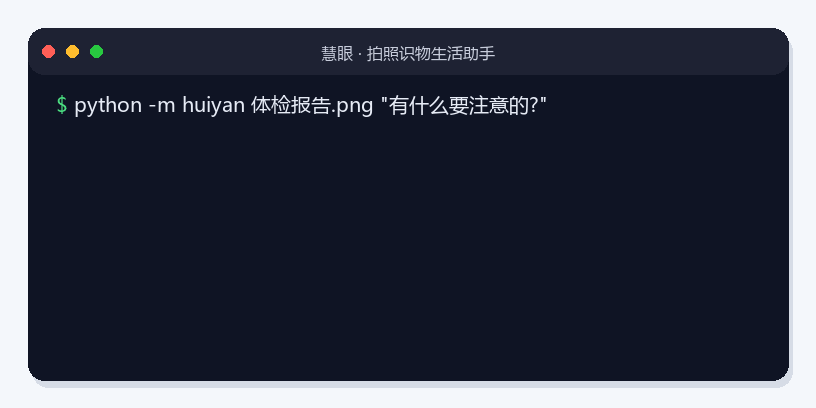
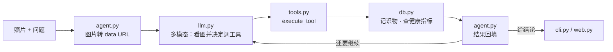

# HuiYan · Photograph-and-Understand Assistant

[](https://github.com/wushiyi105-jpg/huiyan/actions) []() [](./LICENSE) [](https://codecov.io/gh/wushiyi105-jpg/huiyan)



> Take one picture — a health check report, a medicine leaflet, a clothing label, an ingredient list, a plant… it reads the content and gives you a reading plus advice.

A multimodal (vision) everyday agent: upload an image, the model first **identifies the image type**, then decides **which tools to call** (save health metrics / query history for comparison), and finally gives a targeted interpretation. Health metrics live in SQLite and **persist across sessions**, so the next photo shows you the trend.

**Dual CLI + Web entry points, zero third-party dependencies, works out of the box.**

## ✨ Features

- 📷 **Photo recognition** — health check reports / lab sheets, medicine leaflets, clothing labels, food ingredient lists, plants, receipts… the type is inferred automatically
- 🩺 **Health metric extraction** — blood pressure, blood sugar, blood lipids, weight pulled out of the report and stored structurally
- 📈 **Trend comparison** — the next photo is compared with the last one automatically: "your blood sugar is up 0.4 from last time"
- 💊 **Medicine interpretation** — dosage, contraindications, cautions
- 🧵 **Label / ingredient reading** — material composition, washing care, health notes
- 🗒 **Record keeping** — every recognition is archived and can be revisited any time
- 🖥 **Two entry points** — command line plus a Web UI that visualises every tool call
- ⚡ **Zero dependencies** — pure Python standard library, Python 3.10+ is enough

## 🚀 Quick start

```bash
git clone https://github.com/wushiyi105-jpg/huiyan.git
cd huiyan

# configure a model key (the project ships no API key of its own)
cp .env.example .env       # fill in your own LLM_API_KEY
#   or: export LLM_API_KEY=your-key

# start using it
python -m huiyan 体检报告.png "有什么要注意的?"
```

It talks to DeepSeek by default (the cheapest, `deepseek-flash`).
> **⚠️ The project carries no API key of its own — put in your own** (`.env` is already gitignored and never committed).

## 📖 Command reference

```bash
# 🔍 recognise one image (the default entry)
python -m huiyan 体检报告.png "有什么要注意的?"
python -m huiyan 药盒.png
python -m huiyan 衣服标签.png "这面料怎么洗?"

# 📈 view health metrics and recognition records
python -m huiyan records

# 🌐 Web UI (open http://127.0.0.1:8000)
python -m huiyan web --port 8000

# global options
python -m huiyan --json 体检报告.png    # raw JSON output
```

Supports jpg/png/webp, one image under 5MB is recommended.

## 🧠 How it works (multi-step tool calls + vision)

For a photographed health check report, the model executes on its own:

```
① identify the image type → health check report
② save_metric   store each item: systolic 135, fasting glucose 6.2 …
③ query_metrics pull the history in one go and compare trends
→ interpretation: item-by-item notes + reference ranges + trend + diet and exercise advice + when to see a doctor
```

Four tools are available: `save_metric`, `query_metrics`, `save_note`, `list_notes`.

### Data flow

How one piece of data moves between the modules:



## 🔌 Model backends

Works with any **OpenAI-style `/chat/completions`** endpoint, **using your own API key**; three environment variables are all it takes:

| Platform | `LLM_BASE_URL` | `LLM_MODEL` |
|---|---|---|
| DeepSeek (default) | `https://api.deepseek.com` | `deepseek-flash` |
| OpenAI | `https://api.openai.com/v1` | `gpt-4o-mini` |
| Local Ollama | `http://localhost:11434/v1` | `qwen2.5` |

> `LLM_API_KEY` is required; `LLM_BASE_URL` and `LLM_MODEL` are optional.

## 🗂 Layout

```
huiyan/
├── huiyan/
│   ├── agent.py    # multi-step tool loop + multimodal (image) input
│   ├── tools.py    # tool definitions and executor
│   ├── db.py       # SQLite health metrics + recognition records (thread safe, cross-session)
│   ├── llm.py      # LLM client (OpenAI-style API + .env loading + empty-response retry)
│   ├── mock.py     # offline fallback (rule engine / tests)
│   ├── cli.py      # command line entry
│   ├── web.py      # Web UI (image upload + step visualisation)
│   └── __main__.py
├── assets/demo.gif             # demo animation
├── tests/test_huiyan.py        # offline path unit tests
├── .github/workflows/test.yml  # CI
├── .env.example
└── README.md
```

## ✅ Tests

Locally:

```bash
python -m unittest discover tests -v
```

Every push / PR runs the same suite on GitHub Actions across Python 3.10 / 3.11 / 3.12; see the `test` badge at the top.

## 👤 Author

- Name: shiyi
- Email: [wushiyi105@gmail.com](mailto:wushiyi105@gmail.com)
- Phone: 18384198104
- GitHub: [@wushiyi105-jpg](https://github.com/wushiyi105-jpg)

## 📄 License

[MIT](./LICENSE)
