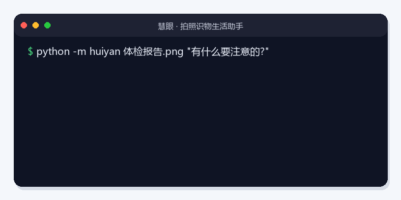
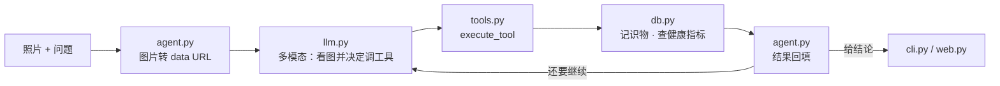

# 慧眼 HuiYan · 拍照识物生活助手

[](https://github.com/wushiyi105-jpg/huiyan/actions) []() [](./LICENSE) [](https://codecov.io/gh/wushiyi105-jpg/huiyan)



> 拍一张图——体检报告、药品说明、衣服标签、配料表、植物……它识别内容并给出解读与建议。

一个多模态(视觉)生活智能体:上传图片,大模型先**识别图片类型**,再决定**调用哪些工具**
(保存健康指标 / 查询历史对比),最后给出针对性解读。健康指标用 SQLite **跨会话保存**,
下次再拍就能看到趋势变化。

**CLI + Web 双入口,零第三方依赖,开箱即用。**

## ✨ 特性

- 📷 **拍照识别** —— 体检报告/化验单、药品说明书、衣服标签、食品配料表、植物、票据……自动判断类型
- 🩺 **健康指标提取** —— 从报告里自动提取血压、血糖、血脂、体重等数值并结构化保存
- 📈 **趋势对比** —— 下次再拍,自动和上次对比,告诉你「血糖比上次升了 0.4」
- 💊 **药品解读** —— 用法用量、禁忌、注意事项
- 🧵 **标签/配料解读** —— 材质成分、洗涤护理、健康提示
- 🗒 **记录留存** —— 每次识别自动存档,可随时回看
- 🖥 **双入口** —— 命令行 + 网页界面(网页可视化每一步工具调用)
- ⚡ **零依赖** —— 纯 Python 标准库,Python 3.10+ 即可运行

## 🚀 快速开始

```bash
git clone https://github.com/wushiyi105-jpg/huiyan.git
cd huiyan

# 配置模型 key(项目不自带任何 API key)
cp .env.example .env       # 填入你自己的 LLM_API_KEY
#   或 export LLM_API_KEY=你的key

# 直接开用
python -m huiyan 体检报告.png "有什么要注意的?"
```

默认对接 DeepSeek(最便宜的 `deepseek-flash`)。
> **⚠️ 项目不自带任何 API key,请填入你自己的 key**(`.env` 已 gitignore,不会提交)。

Docker 运行(容器内用默认端口 8000):

```bash
docker build -t huiyan .
docker run -p 8000:8000 huiyan
```

## 📖 命令参考

```bash
# 🔍 识别一张图片(默认入口)
python -m huiyan 体检报告.png "有什么要注意的?"
python -m huiyan 药盒.png
python -m huiyan 衣服标签.png "这面料怎么洗?"

# 📈 查看健康指标与识物记录
python -m huiyan records

# 🌐 Web 界面(浏览器打开 http://127.0.0.1:8000)
python -m huiyan web --port 8000

# 全局选项
python -m huiyan --json 体检报告.png    # 输出原始 JSON
```

支持 jpg/png/webp,建议单张 < 5MB。

## 🤔 为什么不用通用大模型直接问

通用模型能看着一张化验单说「你的血糖偏高」,但慧眼补的是它做不到的三件事:

1. **指标能比** —— 血压、血糖、血脂、体重被抽成「数值 + 单位」的结构化记录存进 SQLite,下次拍同一类报告自动对比,告诉你「比上次升了 0.4」。通用对话每次都是重新读图,记不住上一次的数值,更做不了单位换算。
2. **数据留在本地** —— 体检报告、药品说明、标签照片都带个人信息,原图与提取出的指标只存在 `data/huiyan.db`,不往云端同步;调模型时只发当前这一张图和问题。
3. **结果可复现** —— 单位归一、趋势计算、指标入库都在本地完成,同一组历史指标算两次结论一致;模型只负责「这张图是什么、上面写了什么」,不参与算差值。
4. **结构化输出** —— 识别的类型、提取的指标、与上次的对比都按固定字段返回,`--json` 可直接给别的程序;通用对话给你一段解读,想存成表格还得手抄。

## 🎯 适用场景

- **体检报告出来先存档**:拍一下化验单,血压血糖血脂自动进库;三个月后复查再拍,直接看到哪项升了、升了多少,不用把两张纸摊在桌上对。
- **药盒说明看不清**:拍药品说明书,拿到用法用量、禁忌和注意事项;说明书字太小、或者已经丢了,也能问。
- **买东西前看成分**:衣服标签看材质和洗涤方式,食品配料表看排在前面的都是什么,拍一张就有解读。

## 🗺 Roadmap

- **指标单位表扩充**:补齐常见化验项的单位与参考区间,减少「这个值算高吗」的含糊。
- **多页报告合并**:一次体检多页图片合成一份记录,而不是一页一条。
- **用药提醒联动**:把药品说明里的用法用量接到康记的药箱记录上,避免两边各记一半。
- **趋势图导出**:把某项指标的历次数值导出成 CSV,复诊时直接给医生看。
- **一键删除原图**:保留指标、删掉照片,减少隐私留存。

## ❓ FAQ

**API key 从哪来?**
需要视觉模型:去智谱开放平台注册,拿 `glm-4.6v-flashx` 这类多模态模型的 key,填进 `.env` 的 `LLM_API_KEY`(也可单独配 `VISION_API_KEY`)。只用文本模型看不了图。

**数据存在哪?会上传吗?**
默认 `data/huiyan.db` 单个 SQLite 文件,识别记录与指标都在这台机器上;调模型时发送当前图片和问题,历史记录不发。

**没有 key 能不能用?**
看图必须有模型,离线时只能浏览已经存下来的历史记录,不能识别新图片。这是能力边界,不硬撑。

**怎么换模型?**
改 `VISION_BASE_URL`、`VISION_MODEL`、`VISION_API_KEY`(或对应的 `LLM_` 变量),见 `.env.example`;换一家多模态服务不用改代码。

**识别出的数值能直接信吗?**
当参考,不当结论。图片模糊、单位混用都可能读错,指标入库前会在输出里标出读到的原文;涉及用药和诊断,仍以医生和原始报告为准。

## 🧠 工作原理(多步工具调用 + 视觉)

拍一张体检报告,模型会自主执行:

```
① 识别图片类型 → 体检报告
② save_metric   保存每一项:收缩压 135、空腹血糖 6.2 …
③ query_metrics 一次性查历史,对比趋势
→ 解读:逐项说明 + 参考范围对照 + 趋势 + 饮食运动建议 + 就医提醒
```

可调用的 4 个工具:`save_metric`、`query_metrics`、`save_note`、`list_notes`。

### 数据流

一条数据在这几个模块之间怎么走：



## 🔌 模型接入

兼容任意 **OpenAI 风格 `/chat/completions`** 接口,**使用你自己的 API key**,改三个环境变量即可:

| 平台 | `LLM_BASE_URL` | `LLM_MODEL` |
|---|---|---|
| DeepSeek(默认) | `https://api.deepseek.com` | `deepseek-flash` |
| OpenAI | `https://api.openai.com/v1` | `gpt-4o-mini` |
| 本地 Ollama | `http://localhost:11434/v1` | `qwen2.5` |

> `LLM_API_KEY` 必填;`LLM_BASE_URL`、`LLM_MODEL` 选填。

## 🗂 目录结构

```
huiyan/
├── huiyan/
│   ├── agent.py    # 多步工具调用循环 + 多模态(图片)输入
│   ├── tools.py    # 工具定义与执行器
│   ├── db.py       # SQLite 健康指标 + 识物记录(线程安全,跨会话)
│   ├── llm.py      # LLM 客户端(OpenAI 风格接口 + .env 加载 + 空响应重试)
│   ├── mock.py     # 离线回退(兜底/测试)
│   ├── cli.py      # 命令行入口
│   ├── web.py      # Web 界面(图片上传 + 步骤可视化)
│   └── __main__.py
├── assets/demo.gif             # 演示动图
├── tests/test_huiyan.py        # 离线路径单元测试
├── .github/workflows/test.yml  # CI
├── .env.example
└── README.md
```

## ✅ 测试

本地:

```bash
python -m unittest discover tests -v
```

每次 push / PR 由 GitHub Actions 在 Python 3.10 / 3.11 / 3.12 上自动跑同一组测试,结果见顶部 `test` 徽章。

## 👤 作者

- 署名：shiyi
- 邮箱:[wushiyi105@gmail.com](mailto:wushiyi105@gmail.com)
- 电话:18384198104
- GitHub:[@wushiyi105-jpg](https://github.com/wushiyi105-jpg)

## 📄 License

[MIT](./LICENSE)
